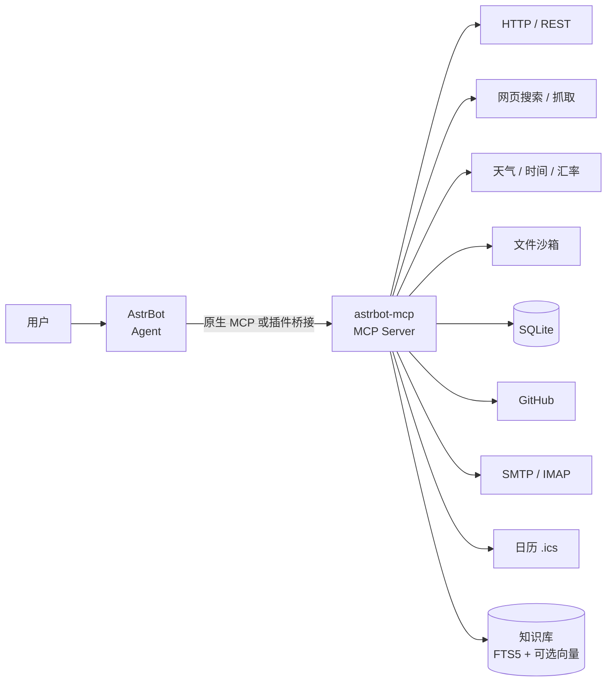

# AstrBot-MCP

[](https://github.com/Astrbot-for-xiaozhiai-server/Astrbot-MCP/actions/workflows/ci.yml)
[](https://www.python.org/)
[](LICENSE)
[](https://m8ven.ai/mcp/astrbot-for-xiaozhiai-server/astrbot-mcp?s=readme)
[](https://m8ven.ai/mcp/astrbot-for-xiaozhiai-server/astrbot-mcp?s=readme)

一个可独立运行的 **MCP（Model Context Protocol）服务器**，外加一个 **AstrBot 插件桥接**。  
它把 HTTP、搜索、天气/时间/汇率、文件、SQLite、GitHub、邮件、日历和可自学习知识库统一封装成 MCP 工具，供 AstrBot Agent 调用。

- MCP 传输：`stdio`、`sse`、`streamable-http`
- 鉴权：HTTP 模式支持 `Authorization: Bearer <token>`，并提供 `/health`
- 安全：SSRF 防护、文件/数据库沙箱、写操作默认关闭
- 知识库：SQLite + FTS5（中文友好的 trigram）+ 可选 OpenAI 兼容向量检索
- AstrBot 插件：多 MCP 服务器聚合、工具自动注册、`/mcp` 指令、知识库自动学习



---

## 1. 快速开始

### 1.1 本地安装

```bash
python3 -m venv .venv
source .venv/bin/activate
pip install -e ".[dev]"

cp config.example.yaml config.yaml
# 按需填写 API Key，或使用环境变量
astrbot-mcp --check-config      # 查看解析后的配置（密钥已脱敏）
astrbot-mcp --list-tools        # 查看注册了哪些工具
```

### 1.2 运行 MCP 服务器

```bash
# stdio（由 AstrBot 等客户端拉起）
astrbot-mcp --config config.yaml

# Streamable HTTP
astrbot-mcp --config config.yaml --transport streamable-http --host 0.0.0.0 --port 8765

# 旧版 SSE
astrbot-mcp --config config.yaml --transport sse --host 0.0.0.0 --port 8765
```

HTTP 模式端点：

| 路径 | 说明 |
| --- | --- |
| `/mcp` | Streamable HTTP MCP 端点 |
| `/sse` | SSE 端点 |
| `/messages/` | SSE 消息端点 |
| `/health` | 健康检查（无需鉴权） |

配置了 `server.auth_token` 后，除 `/health` 外都需要：

```http
Authorization: Bearer <token>
```

### 1.3 Docker

```bash
cp config.example.yaml config.yaml
# 修改 config.yaml 中的 auth_token / 服务开关 / API Key
docker compose up -d --build
curl http://127.0.0.1:8765/health
```

数据目录 `./data` 会被挂载到容器内 `/app/data`，包含知识库、文件沙箱、SQLite 和日历。

---

## 2. 接入 AstrBot

有两条路，任选其一；也可以同时使用。

### 方式 A：AstrBot 原生 MCP（最简单）

在 AstrBot WebUI 打开 **插件 → MCP → 新增服务器**，粘贴下面任一配置。

**stdio（服务器安装在 AstrBot 所在环境）**

```json
{
  "transport": "stdio",
  "command": "/path/to/Astrbot-MCP/.venv/bin/python",
  "args": ["-m", "astrbot_mcp", "--config", "/path/to/Astrbot-MCP/config.yaml"],
  "cwd": "/path/to/Astrbot-MCP"
}
```

> AstrBot 会校验 stdio 命令名。请使用 `.../bin/python -m astrbot_mcp`，不要直接写 `astrbot-mcp`（命令名 `astrbot-mcp` 不在默认白名单中）；`python`、`python3`、`uv`、`uvx`、`npx` 等均在白名单内。

**Streamable HTTP**

```json
{
  "transport": "streamable_http",
  "url": "http://127.0.0.1:8765/mcp",
  "headers": { "Authorization": "Bearer <你的 token>" }
}
```

AstrBot 与 MCP 服务器都在 Docker Compose 中时，把 `127.0.0.1` 换成服务名，例如 `http://astrbot-mcp:8765/mcp`。

### 方式 B：插件桥接（聚合多个 MCP 服务器）

插件适合以下场景：

- 同时连接多个 MCP 服务器，统一管理
- 把每个 MCP 工具自动注册成 AstrBot 的 LLM 工具
- 用 `/mcp` 指令手动查看/调用
- 开启知识库自动学习

安装：

```bash
# 把本仓库的 astrbot_plugin 目录复制到 AstrBot 的插件目录，并改名为插件名
cp -r astrbot_plugin /path/to/AstrBot/data/plugins/astrbot_plugin_mcp_bridge
```

重启 AstrBot（或在 WebUI 重载插件），然后在 **插件管理 → MCP 服务桥接 → 配置** 中填写 `servers_json`：

```json
{
  "mcpServers": {
    "astrbot-mcp": {
      "transport": "stdio",
      "command": "/path/to/Astrbot-MCP/.venv/bin/python",
      "args": ["-m", "astrbot_mcp", "--config", "/path/to/Astrbot-MCP/config.yaml"],
      "cwd": "/path/to/Astrbot-MCP"
    },
    "remote-example": {
      "transport": "streamable_http",
      "url": "http://127.0.0.1:8765/mcp",
      "headers": { "Authorization": "Bearer <token>" }
    }
  }
}
```

旧版 AstrBot 没有 `template_list` 可视化编辑器时，`servers_json` 同样可用。也支持直接写数组或“名称 → 配置”的对象：

```json
[
  { "name": "astrbot-mcp", "command": "python", "args": ["-m", "astrbot_mcp"] }
]
```

插件配置项（`_conf_schema.json`）：

| 配置 | 默认 | 说明 |
| --- | --- | --- |
| `servers` | `[]` | 可视化服务器列表（AstrBot ≥ 4.10.4） |
| `servers_json` | `""` | JSON 配置，与 `servers` 合并，同名时优先 |
| `auto_register` | `true` | 把 MCP 工具自动注册为 LLM 工具 |
| `tool_prefix` | `mcp` | 自动工具名前缀，最终形如 `mcp_<server>_<tool>` |
| `tool_name_max_length` | `64` | 工具名最大长度，超长会加哈希后缀 |
| `tool_denylist` | `""` | 全局工具黑名单，逗号分隔 |
| `max_tools_per_server` | `200` | 每个服务器最多注册的工具数 |
| `connect_timeout` | `30` | 连接超时（秒） |
| `tool_timeout` | `120` | 工具调用超时（秒） |
| `auto_learn` | 见下文 | 知识库自动学习配置 |

`auto_register=false` 时仍保留三个通用工具：

- `mcp_list_servers`：查看服务器与连接状态
- `mcp_list_tools(server)`：查看某服务器的工具
- `mcp_call_tool(server, tool, arguments)`：手动调用

插件指令：

```text
/mcp list                         查看服务器状态
/mcp tools <server>               查看工具列表
/mcp call <server> <tool> <json>  调用工具
/mcp reload                       重连并重新注册（管理员）
/mcp help                         帮助
```

---

## 3. 工具清单

### 通用 HTTP

| 工具 | 说明 |
| --- | --- |
| `http_request` | 任意 REST 请求；支持 method/headers/params/JSON/原始 body、大小限制、逐跳重定向校验 |

### 搜索与抓取

| 工具 | 说明 |
| --- | --- |
| `web_search` | DuckDuckGo / Tavily / Bing / SearXNG |
| `web_fetch` | 抓取网页并提取正文与链接（带 SSRF 防护） |

### 公共 API（无需 Key）

| 工具 | 说明 |
| --- | --- |
| `get_weather` | Open-Meteo 天气与多日预报 |
| `get_time` | 任意 IANA 时区当前时间 |
| `convert_currency` | 实时汇率换算 |

### 文件沙箱

| 工具 | 说明 |
| --- | --- |
| `fs_list` / `fs_read` / `fs_stat` | 列目录、按行读文本、查看元信息 |
| `fs_search` | 在文本文件中搜索（支持正则） |
| `fs_write` / `fs_mkdir` / `fs_delete` | 写操作，需显式开启 `allow_write` / `allow_delete` |

所有路径都被限制在 `services.files.root` 内，符号链接逃逸会被拒绝。

### SQLite

| 工具 | 说明 |
| --- | --- |
| `sqlite_list_tables` / `sqlite_describe` | 查看表和结构 |
| `sqlite_query` | 只读连接执行查询 |
| `sqlite_execute` | 单条写语句，需 `services.sqlite.allow_write=true` |

数据库文件被限制在 `services.sqlite.root` 内。

### GitHub

`github_search_repos`、`github_get_repo`、`github_list_issues`、`github_get_issue`、`github_get_file`、`github_search_code`、`github_create_issue`。

- 公开读取不需要 token；代码搜索和写操作需要 `GITHUB_TOKEN`
- `github_create_issue` 还需要 `services.github.allow_write=true`

### 邮件（默认关闭）

`mail_send`、`mail_list`、`mail_read`。使用标准库 SMTP/IMAP，需在 `services.mail` 配置服务器与账号。

### 日历（默认关闭）

`calendar_list`、`calendar_list_events`、`calendar_add_event`、`calendar_delete_event`。  
数据保存为 `.ics` 文件，可被其他日历软件导入；写入时会嵌入 `VTIMEZONE`，时区可正确往返。

### 知识库与自学习

| 工具 | 说明 |
| --- | --- |
| `kb_add` | 按 `source` 添加或覆盖文档 |
| `kb_remember` | 记住一条事实，内容哈希自动去重 |
| `kb_search` | 关键词 + 可选向量检索，RRF 融合 |
| `kb_learn_url` | 抓取网页、提取正文并入库 |
| `kb_learn_file` | 从 `files.root` 内文本文件学习 |
| `kb_list` / `kb_get` / `kb_delete` | 管理文档 |
| `kb_stats` / `kb_reindex` / `kb_export` | 统计、重建 FTS、导出 JSON |

知识库默认使用 SQLite FTS5：

- 优先 `trigram` 分词，对中文子串检索友好
- 不支持 trigram 的环境回退 `unicode61`
- FTS5 完全不可用时自动回退 `LIKE`

可选向量检索（任意 OpenAI 兼容 `/embeddings` 接口）：

```yaml
services:
  knowledge:
    embedding:
      enabled: true
      base_url: ${EMBEDDING_BASE_URL}
      api_key: ${OPENAI_API_KEY}
      model: text-embedding-3-small
      dimensions: 0
```

---

## 4. 知识库自动学习

有两种“自学习”方式。

### 4.1 Agent 主动学习

模型在对话中直接调用：

```text
kb_remember(content="用户偏好中文回答", tags="preference")
kb_learn_url(url="https://example.com/article", tags="docs")
```

建议在 AstrBot 的 system prompt 中加一句：

> 当用户提供值得长期保存的事实、偏好或结论时，调用 `kb_remember` 保存；需要参考资料时先调用 `kb_search`。

### 4.2 插件自动学习

在插件配置中开启：

```json
{
  "auto_learn": {
    "enabled": true,
    "knowledge_server": "astrbot-mcp",
    "tool_name": "kb_remember",
    "tags": "auto-learned",
    "min_message_chars": 20,
    "max_conversation_chars": 4000,
    "learn_in_group": false
  }
}
```

工作方式：

1. 每轮 LLM 回复后，插件用当前会话模型（或 `provider_id` 指定模型）提取长期记忆
2. 提取结果写入 `knowledge_server` 的 `tool_name`
3. 相同对话内容会被哈希去重
4. 默认只在私聊触发，避免把群聊内容写入长期记忆

注意：这会为每轮对话额外调用一次 LLM，产生 token 消耗；不需要时请保持关闭。

---

## 5. 配置参考

完整配置见 [`config.example.yaml`](config.example.yaml)。

### 5.1 环境变量

所有配置项都支持 `${VAR}` 和 `${VAR:-default}` 展开。本地开发可先复制模板：

```bash
cp .env.example .env        # docker compose 会自动读取 .env
```

| 变量 | 用途 |
| --- | --- |
| `ASTRBOT_MCP_CONFIG` | 配置文件路径 |
| `ASTRBOT_MCP_TRANSPORT` | 覆盖传输方式 |
| `ASTRBOT_MCP_HOST` / `ASTRBOT_MCP_PORT` | 覆盖监听地址/端口 |
| `ASTRBOT_MCP_AUTH_TOKEN` | HTTP Bearer token |
| `GITHUB_TOKEN` | GitHub API token |
| `TAVILY_API_KEY` / `BING_SEARCH_API_KEY` / `SEARXNG_BASE_URL` | 搜索后端 |
| `MAIL_PASSWORD` | 邮箱密码/授权码 |
| `OPENAI_API_KEY` / `EMBEDDING_BASE_URL` / `EMBEDDING_MODEL` | 向量检索 |

### 5.2 路径规则

- 相对路径以**配置文件所在目录**为基准
- `files.root`、`sqlite.root`、`calendar.root`、`knowledge.db_path` 会被转换为绝对路径
- 文件、数据库、日历、知识库导出均限制在各自根目录内

### 5.3 安全模型

| 保护 | 说明 |
| --- | --- |
| SSRF | 默认拒绝私网/回环/链路本地/保留地址；重定向逐跳校验 |
| 域名策略 | `security.allowed_domains` 白名单、`blocked_domains` 黑名单 |
| 写操作 | 文件、SQLite、GitHub 写操作默认关闭 |
| 路径逃逸 | `..`、绝对路径、符号链接逃逸都会被拒绝 |
| HTTP 鉴权 | `server.auth_token` 非空时强制 Bearer token |
| 密钥 | 支持环境变量注入；`--check-config` 自动脱敏 |

残余风险：DNS 在校验与连接时各解析一次，恶意 DNS 重绑定理论上可绕过；对不可信网络建议配合 egress 防火墙/反向代理。日历、知识库是明文文件，请自行控制目录权限。

---

## 6. 配置示例

### 6.1 使用 Tavily 搜索

```bash
export TAVILY_API_KEY=tvly-xxx
```

```yaml
services:
  web_search:
    provider: tavily
    api_key: ${TAVILY_API_KEY}
```

DuckDuckGo 无需 Key，但数据中心 IP 可能被限流；此时会回退到 Lite 端点，仍失败则建议改用 Tavily/Bing/SearXNG。

### 6.2 开启文件与 SQLite 写入

```yaml
services:
  files:
    root: ./data/files
    allow_write: true
    allow_delete: false
  sqlite:
    root: ./data/sqlite
    allow_write: true
```

### 6.3 邮件

```yaml
services:
  mail:
    enabled: true
    smtp_host: smtp.example.com
    smtp_port: 465
    smtp_ssl: true
    username: bot@example.com
    password: ${MAIL_PASSWORD}
    from_addr: bot@example.com
    imap_host: imap.example.com
    imap_port: 993
    imap_ssl: true
```

国内邮箱通常需要使用“授权码”而不是登录密码。

### 6.4 允许访问内网服务

```yaml
security:
  allow_private_networks: true
```

仅在你清楚风险时开启，例如让 MCP 访问局域网 Home Assistant / Ollama。

---

## 7. 开发与测试

```bash
python3 -m venv .venv
source .venv/bin/activate
pip install -e ".[dev]"

pytest -q                                  # 全部单元测试（离线，不访问网络）
pytest -q --cov=astrbot_mcp --cov-report=term-missing
ruff check src astrbot_plugin tests        # Lint
ruff format --check src astrbot_plugin tests
astrbot-mcp --check-config
astrbot-mcp --list-tools
```

测试通过 `httpx.MockTransport` 模拟外部 API，不会发起真实网络请求；GitHub Actions
（`.github/workflows/ci.yml`）会在 Python 3.10–3.13 上运行 lint、测试和 CLI 冒烟检查。

目录结构：

```text
.
├── src/astrbot_mcp/
│   ├── __main__.py        # CLI 入口
│   ├── server.py          # FastMCP、HTTP 网关、鉴权、/health
│   ├── config.py          # YAML + 环境变量 + 路径解析
│   ├── net.py             # SSRF 防护与安全请求
│   ├── registry.py        # 服务注册
│   └── services/          # 各服务适配器
├── astrbot_plugin/        # AstrBot 插件（复制到 data/plugins/）
├── tests/                 # pytest 用例（conftest.py 提供离线 HTTP 夹具）
├── .github/workflows/     # CI：lint + 多版本测试
├── config.example.yaml
├── Dockerfile
└── docker-compose.yml
```

---

## 8. FAQ

**AstrBot 报 “command not allowed” 或找不到 `uvx`/`npx`**  
AstrBot 只允许白名单中的命令，并且依赖必须装在 AstrBot 所在环境/容器内。优先使用 `<venv>/bin/python -m astrbot_mcp`；Docker 部署建议改用 HTTP 传输。

**Docker 里 AstrBot 连不上 `127.0.0.1:8765`**  
容器内的 `127.0.0.1` 指向 AstrBot 自己。使用同一 Compose 网络中的服务名，或宿主机 IP。

**MCP 工具没有出现在模型的函数列表里**  
确认模型支持 function calling、插件已连接服务器；工具太多时可用 `tool_denylist`、每个服务器的 `ignore_tools`、`max_tools_per_server` 限制数量，或关闭 `auto_register` 只用 `mcp_call_tool`。

**搜索返回 0 条**  
DuckDuckGo 可能限流。配置 Tavily / Bing / SearXNG 作为后端。

**知识库中文检索效果**  
默认使用 SQLite FTS5 `trigram`；若你的 SQLite 太旧，会回退到 `unicode61` 或 `LIKE`。可开启向量检索提升语义召回。

**邮件/日历工具没有出现**  
它们在示例配置中默认 `enabled: false`，开启并填好配置后重启即可。

---

## 9. 许可证

[MIT](LICENSE)
[](https://m8ven.ai/mcp/astrbot-for-xiaozhiai-server-astrbot-mcp-bllve3?s=readme)